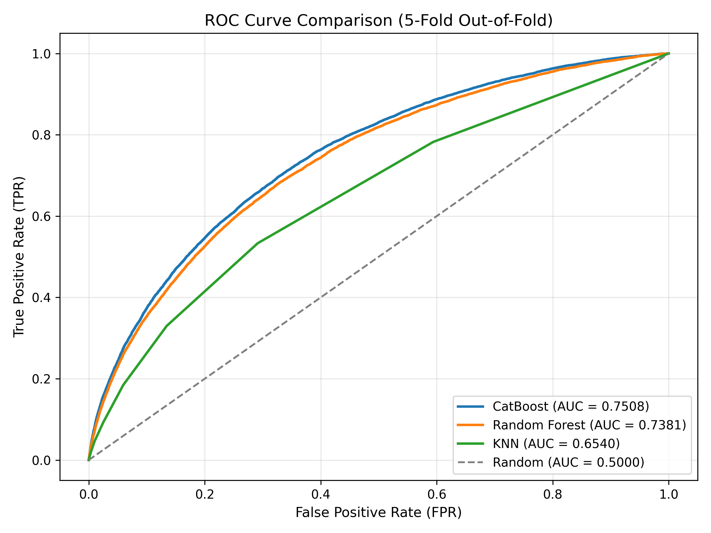

# Home Credit Default Risk — Credit Scoring Pipeline

End-to-end credit risk scoring pipeline developed for the **Home Credit Default Risk** competition, part of the **GCI — Data Science & Deep Learning** course offered by the **University of Tokyo** (via the Omnicampus platform).

The objective is to predict the **Probability of Default (`TARGET`)** for loan applicants using imbalanced tabular financial data, evaluated with **ROC-AUC** as the primary metric.

---

## Project Overview

This repository transitions an experimental credit scoring workflow into a **modular, leak-free, production-structured Machine Learning pipeline**. It covers data ingestion, missing-value auditing, exploratory data analysis (EDA), domain-driven anomaly cleaning, leak-free categorical encoding, 5-fold stratified cross-validation benchmarking, and out-of-fold ensemble inference.

* **Dataset Volume:** 171,202 training applications and 61,500 test applications across 19 domain-selected features spanning four risk pillars (*External Credit Scores*, *Financial Capacity & Contract Terms*, *Temporal Stability*, and *Socioeconomic Profile*).
* **Validation Strategy:** `5-Fold Stratified Cross-Validation` (`random_state=99`) evaluated via **ROC-AUC**, generating combined **Out-of-Fold (OOF)** ROC curves for a fair comparison across model families.
* **Probability Calibration:** Synthetic oversampling techniques (e.g., SMOTE) and undersampling are intentionally avoided to preserve true default probability calibration.

---

## Key Exploratory Data Analysis (EDA) Insights

* **Severe Class Imbalance (`TARGET`):** Default cases (`1`) represent only **~8%** of applications (versus ~92% repaid on time), making accuracy uninformative and justifying **ROC-AUC** as the primary evaluation metric.
* **Informative Missingness (MNAR):** `EXT_SOURCE_1` (~69.5% missing), `EXT_SOURCE_3` (~31.9% missing), and `OWN_CAR_AGE` (~66.0% missing) exhibit Missing-Not-At-Random patterns—for bureau scores, missingness directly identifies *thin-file* applicants with limited credit history.
* **Data Provenance & Outliers:** Self-reported income (`AMT_INCOME_TOTAL`) displays heavy right-skewness and extreme outliers, while `DAYS_EMPLOYED` contains a systemic placeholder (`365243`, ~1,000 years) representing pensioners and unemployed applicants, and `OWN_CAR_AGE` exhibits anomalous spikes above 60 years.
* **High Cardinality & Sparsity:** `ORGANIZATION_TYPE` spans 58 raw categories and `OCCUPATION_TYPE` contains several rare professions with fewer than 1,500 records.

---

## Preprocessing & Feature Engineering

All statistical parameters (quantiles, medians, rare-category thresholds, and encoders) are fitted **strictly on the training set** and applied to the test set to prevent data leakage (`src/preprocessing.py`).

### Missing Value & Anomaly Treatment

| Feature | Applied Strategy | Rationale |
| :--- | :--- | :--- |
| **`AMT_INCOME_TOTAL`** | Upper-bound Winsorization at the **99.9th percentile** | Mitigates extreme self-reported income outliers without dropping test records. |
| **`EXT_SOURCE_2`** | Median imputation | Negligible missing rate (~0.2%) with slight left skewness. |
| **`EXT_SOURCE_1` / `EXT_SOURCE_3`** | Median imputation + Binary indicator (`_IS_MISSING`) | Preserves the predictive risk signal of *thin-file* applicants (MNAR). |
| **`DAYS_EMPLOYED`** | Replace `365243` with `0` + Anomaly flag (`DAYS_EMPLOYED_ANOM`) | Zero days worked aligns with business reality for pensioners/unemployed clients. |
| **`OWN_CAR_AGE`** | Replace `> 60` with `NaN`, decade binning (`// 10`, capped at `3`, `-1` for no car) + One-Hot Encoding | Captures non-linear vehicle depreciation while cleanly handling ~66% non-car owners. |

### Categorical Consolidation & Encoding

* **Binary Mapping:** `CODE_GENDER` (residual `'XNA'` mapped to mode `'F'`) and `NAME_CONTRACT_TYPE`.
* **Ordinal Encoding:** `NAME_EDUCATION_TYPE` mapped along its natural hierarchy (`0` = *Lower secondary* to `4` = *Academic degree*).
* **Rare Consolidation + One-Hot Encoding:** `NAME_INCOME_TYPE` rare classes (`Unemployed`, `Student`, `Businessman`, `Maternity leave`) grouped into `'Other'` prior to One-Hot Encoding.
* **Domain Consolidation + Out-of-Fold `TargetEncoder`:**
  * `OCCUPATION_TYPE`: Professions with `< 1,500` records grouped into `Other_Office_Staff` and `Other_Service_Labor`.
  * `ORGANIZATION_TYPE`: Reduced from 58 categories to ~18 macro-sectors (`XNA` $\rightarrow$ `Unemployed_Pensioner`, hierarchical prefix merging for `Trade`/`Industry`/`Transport`/`Business Entity`, and `< 1,000` records $\rightarrow$ `Rare_Organization`).

---

## Model Benchmark (5-Fold Stratified CV)

All models are evaluated under the exact same cross-validation splits (`random_state=99`). `StandardScaler` is wrapped inside a `sklearn.pipeline.Pipeline` exclusively for KNN to prevent fold leakage, while tree-based ensembles operate on raw scales.

| Model | Mean ROC-AUC | Std ROC-AUC | Notes |
| :--- | :---: | :---: | :--- |
| **CatBoost (Champion)** | **0.75077** | **± 0.00249** | Symmetric trees; selected for 5-fold OOF ensemble inference |
| **Random Forest** | `0.73817` | `± 0.00213` | Bagging tree ensemble (`max_depth=12`, `min_samples_leaf=20`) |
| **KNN (Baseline)** | `0.65405` | `± 0.00449` | Distance-based baseline with leak-free `StandardScaler` pipeline |



### Final Ensemble Inference
* Predictions for all **61,500** unseen test applications are generated by averaging probabilities across the **5 CatBoost models** trained on each CV fold (`output/submission.csv`).
* **Calibration Check:** Predicted default probabilities range from `0.0010` to `0.7613` with a mean of **`0.0883`**, closely aligned with the ~8% historical default rate observed in the training set.

---

## Repository Architecture

```text
home-credit-default-risk/
├── data/
│   ├── raw/                         # Immutable original datasets (train.csv, test.csv, sample_submission.csv)
│   └── processed/                   # Leak-free engineered datasets (train_final.csv, test_final.csv)
├── docs/                            # Data dictionary and domain documentation
├── notebooks/
│   ├── 01_eda_preprocessing.ipynb   # Exploratory analysis, anomaly auditing & preprocessing experiments
│   └── 02_machine_learning.ipynb    # Model benchmarking, ROC curves & ensemble evaluation
├── output/                          # Generated test predictions (submission.csv)
├── reports/
│   ├── figures/                     # Automatically exported EDA & ROC visualizations (.png)
│   ├── missing_values_audit.csv     # Missingness audit report generated by run_eda.py
│   └── model_benchmark.csv          # Cross-validation benchmark summary generated by main.py
├── src/
│   ├── __init__.py
│   ├── config.py                    # Centralized paths, feature schemas, maps & hyperparameters
│   ├── preprocessing.py             # Leak-free cleaning, encoding, imputation & quality gates
│   └── train.py                     # 5-Fold Stratified CV benchmark, ROC plotting & inference
├── main.py                          # Main orchestrator script for the end-to-end ML pipeline
├── run_eda.py                       # Orchestrator script for Exploratory Data Analysis (EDA)
├── .gitignore                       # Rules to ignore virtual environments and large CSV files
├── requirements.txt                 # Project dependencies
└── README.md                        # Project documentation
```
